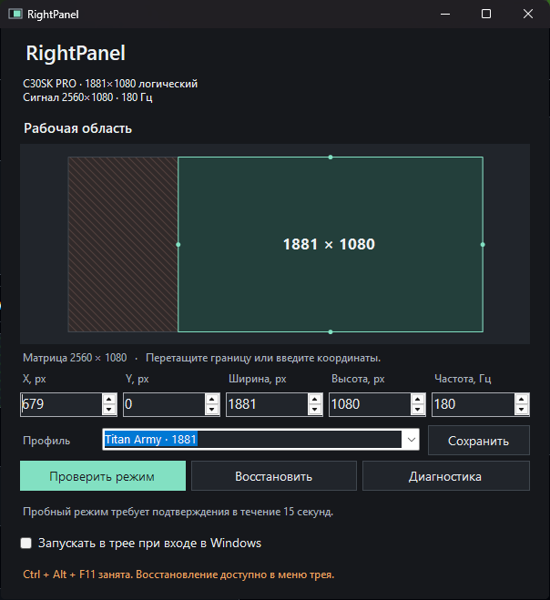

# RightPanel

An experimental Windows utility for placing the desktop inside the working portion of a damaged 2560 × 1080 monitor. It uses Windows Display Configuration and NVIDIA NVAPI to request a logical desktop and a separate physical image region.

**Experimental.** Display-driver behavior varies. A backup display or another way to recover display settings can be helpful. Fullscreen video in specific browsers and players has not yet been verified. Exclusive fullscreen games may reset or center the image.

## Download

[Download RightPanel.exe](RightPanel.exe) · Windows 11 x64, NVIDIA GPU and driver, one active display. The executable is unsigned.

## How to use

1. Run RightPanel.exe and set the working area's X, Y, width, height and a refresh rate supported by your current physical connection.
2. Select **Проверить режим**. If the picture is usable, confirm within 15 seconds. A separate process requests restoration if the trial is not confirmed.
3. To restore a confirmed configuration, select **Восстановить** or press Ctrl+Alt+F11 while RightPanel is running. The interface reports when the hotkey cannot be registered.
4. Profiles are saved locally. Closing the window hides the application in the system tray. Autostart is optional.

The built-in example uses X=679, Y=0 and 1881 × 1080. You can enter another rectangle inside 2560 × 1080. If a custom NVIDIA mode with the same dimensions already exists, the app refuses to overwrite it. The active state and backup are stored in %LOCALAPPDATA%\RightPanel.

## Test results and limitations

- Tested on a GeForce GTX 1650, C30SK PRO, Windows 11 and HDMI at 180 Hz. Windows reported 1881 × 1080 logical and 2560 × 1080 physical, with the desktop image region at X=679. Physical pixel placement was not independently measured.
- Trial timeout and manual restoration after confirmation were tested. This does not guarantee recovery after power loss, a driver hang or a topology change.
- A DXGI borderless test retained the CCD configuration. Browser and player fullscreen video, reboot persistence, input latency and FPS have not been verified.
- In a DXGI exclusive fullscreen test the driver centered the 1881-pixel source at X=339, exposing part of the image to the damaged area. This release does not correct that behavior.
- The tested HDMI connection reports 60, 120 and 180 Hz at 2560 × 1080. 200 Hz depends on the monitor input, cable and driver modes and was not tested.
- The UI and physical signal dimensions are currently fixed to 2560 × 1080. Multiple active monitors are not supported.

## Build from source

From a Windows PowerShell prompt in this directory, run .\build.ps1. The build uses the Windows .NET Framework C# compiler and system assemblies.

## Background

This experiment was motivated by [ScreenShift](https://github.com/Bluremind/ScreenShift). Review the [ScreenShift license](https://github.com/Bluremind/ScreenShift/blob/main/LICENSE) separately when using its original code or binaries. RightPanel uses Windows CCD and NVIDIA NVAPI.

The repository currently has no declared open-source license.
